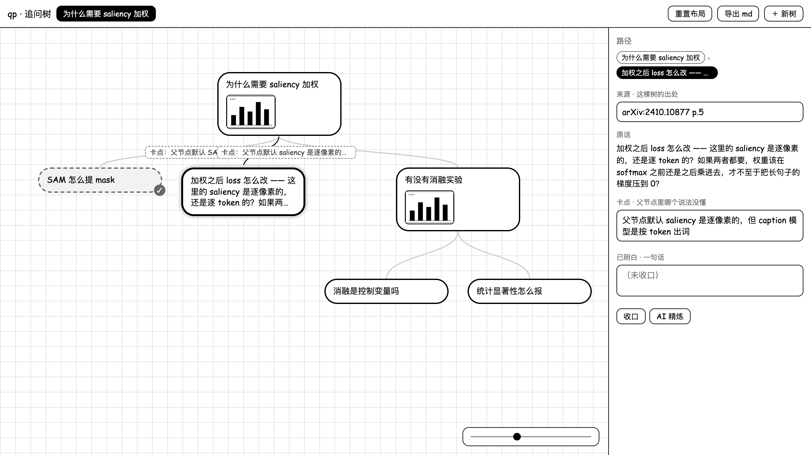
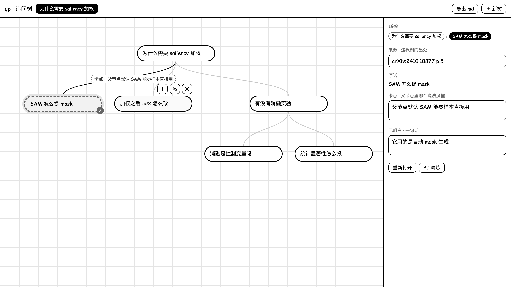
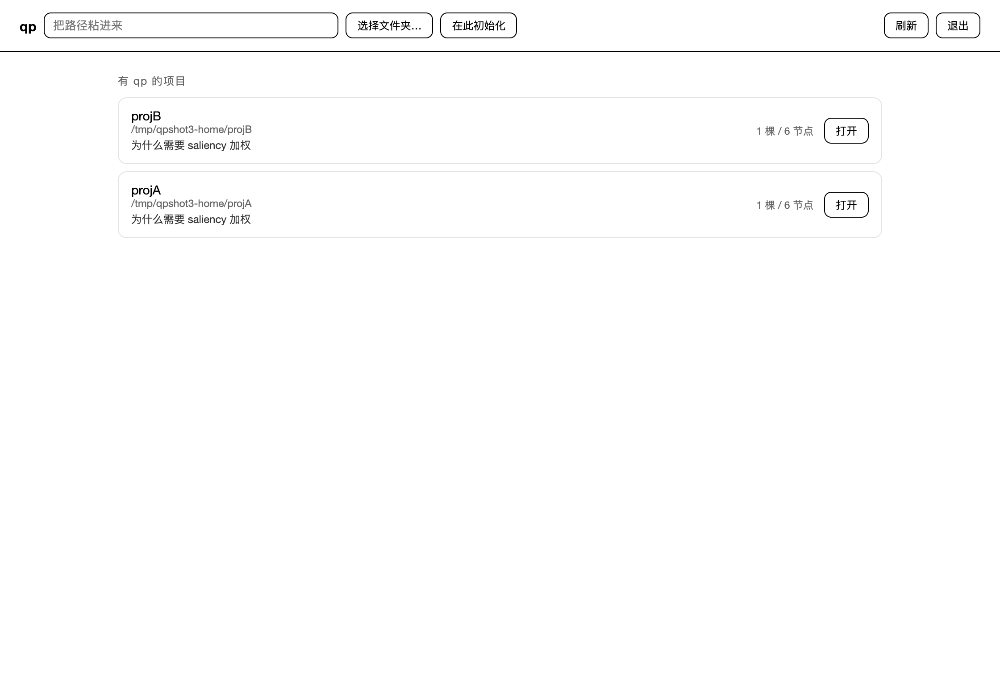

# qp · 追问树

读论文、查资料的时候，一个问题常常牵出下一个问题。等一路追完，最初想问什么已经记不清了。

qp 把这条追问链路记录成一棵树：每个节点是你当时的问题原话，根节点保留最初的问题。

> 项目主页（含功能演示）：<https://c-allergic.github.io/qp/>



---

## 为什么做这个

提问式学习有一个常见的副作用：为了弄清 A 去查 B，为了 B 又得先看懂 C；等到终于理解 C，已经想不起来为什么出发。

普通笔记通常只保留结论，而"当时卡在哪个说法、为什么会问到这里"这一层没有被记下来。但在复习、或同一个知识点再次卡住的时候，这一层往往更有用。

qp 做了一个具体的选择：

- 根节点始终是最初的问题，可以随时回到出发点；
- 每个子节点记录的不是"子议题"，而是"父节点里哪个说法没弄懂"；
- 一条分支弄明白后可以收口，写下卡点和结论。

---

## 功能

### 树：逐层追问

点气泡上的 `＋`，气泡就地变成输入框，回车生成一个子节点。任意节点都可以添加子节点，不限于叶子，因此树不会退化成一条链。

| 操作 | 效果 |
|---|---|
| 光标移到气泡 | 显示 `＋` 加子问题 / `✎` 改原话 / `💬` 加入对话 / `✕` 删除该子树 |
| 拖动气泡 | 自由移动节点，连线随之更新，位置会被记住 |
| 点击气泡 | 切换焦点，从根到该节点的路径加深显示，右侧面板同步 |
| 右上角「重置布局」 | 所有气泡回到自动排列的位置 |



### 收口：卡点与已明白

一条分支想通之后，在右侧填写「卡点」（父节点里哪个说法没弄懂）和「已明白」（一句话结论），点「收口」。已收口的分支在树上显示 `✓`。

> 局部小结可以写在节点的「已明白」里，不必单独开一篇笔记。

### 笔记

树记录还没想通、需要继续追下去的内容；笔记记录已经想通、需要成篇写下来的内容。二者并列存放。

右上角「＋ 笔记」新建 markdown 笔记，编辑时带预览并自动保存（⌘S 立即保存）。

### 图片

`⌘V` 直接粘贴截图，生成一个图片节点（也可以使用 `qp img`）。相同图片只保留一份，可以单独写描述，导出时一并带出。

### 对话（可选）

右侧第二个页签，支持多轮对话和流式输出，随时可以停止。点气泡上的 💬 会把该节点的问题填入输入框。

### 导出与 AI 梳理

顶栏「导出」有两种方式：

- **直接导出 md**：把整棵树导出为 markdown 并下载；
- **AI 梳理问题脉络**：让模型通读整棵树，列出你提出过哪些问题、每个问题后面跟着什么回答或更深的追问。结果出现在一个可编辑的文本框里，修改后再点「保存 md」，不会自动保存。

```markdown
1. **SAM 凭什么零样本**
   - 回答：它用自动 mask 生成，不需要人工 prompt
   - 更深的问题：那 zero-shot 覆盖到什么程度
2. **加权之后 loss 怎么改**
   - 回答：把 mask 当权重乘进逐像素 loss
```

### 只读快照

```bash
qp render     # 生成 .qp/index.html：自包含，可离线打开
```

可以把快照发给他人或存档，对方直接打开即可查看完整的树。

### 双击打开 / 项目管理器

```bash
qp install-app    # 生成 ~/Applications/qp.app，之后可双击启动
qp home           # 项目管理器：列出本机所有 qp 项目，点选进入
```



---

## 安装

### 环境需求

| | 需要 | 说明 |
|---|---|---|
| 系统 | macOS | 原生窗口、双击启动和项目管理器的目录选择依赖 macOS 功能；命令行与浏览器界面本身跨平台，但未在 Windows / Linux 上验证 |
| Python | 3.8 或更高 | 系统自带即可 |
| 浏览器 | 任意，推荐 Chrome | 用于打开界面；使用原生窗口时不依赖 Chrome |
| pywebview | 可选 | 安装后可用 `qp app` 打开原生窗口；未安装时回退到 Chrome |
| 模型端点 | 可选 | 「对话」和「AI 梳理」需要；其余功能不联网 |

### 安装步骤

将仓库中的 `qp.py`、`qp-ui.html`、`qp-home.html` 放在同一目录，再添加一条软链：

```bash
# 1. 选择一个目录存放
mkdir -p ~/apps/qp && cd ~/apps/qp
#    将 qp.py / qp-ui.html / qp-home.html 放入该目录

# 2. 添加全局命令（路径按实际存放位置修改）
ln -sf ~/apps/qp/qp.py /opt/homebrew/bin/qp      # Intel Mac 使用 /usr/local/bin

# 3. 在需要记录的目录初始化
cd ~/Documents/我在读的论文
qp init
```

### 使用

```bash
qp new "saliency 加权到底是怎么做的" --source "arXiv:2410.10877 p.5"
qp add @ "用 SAM 提 mask 那步，SAM 不是要 prompt 吗，这里凭什么直接用"
qp add @ "那它的 zero-shot 到底覆盖到什么程度"
qp tree                 # 查看树
qp ui                   # 打开图形界面（推荐）
```

`@` 表示当前焦点节点，因此连续执行 `qp add @ "..."` 就能逐层往下追问。

收口一条分支：

```bash
qp close @ --blocker "父节点默认 SAM 能零样本直接用，没说前提" \
           --resolution "它用自动 mask 生成，不需要人工 prompt，但域偏移明显"
```

### 配置模型（可选）

```bash
qp llm --list                                    # 查看预设
qp llm --preset zhipu --key sk-xxx --global       # 配置一次，所有项目共用
qp llm --test                                     # 发送一句测试请求
```

不配置也能使用除「对话」和「AI 梳理」以外的全部功能。也可以手写 `.qp/config.json`，或指向本地 Ollama。

---

## 常用命令

| 命令 | 作用 |
|---|---|
| `qp init` | 在当前目录创建 `.qp/` |
| `qp new "<原话>" [--source S]` | 新建一棵树（根节点为最初的问题） |
| `qp add [<id>] "<原话>"` | 添加子问题；省略 id 时挂到当前焦点 |
| `qp edit <id> "<原话>"` | 修改某个节点的原话 |
| `qp close <id> [--blocker B] [--resolution R]` | 收口：记录卡点与已明白 |
| `qp rm <id>` | 删除节点及其整棵子树 |
| `qp ls` / `qp tree` / `qp path <id>` | 列出 id / 打印 ascii 树 / 打印从根到该节点的路径 |
| `qp render` | 生成只读快照 `.qp/index.html` |
| `qp md [-o FILE]` | 导出 markdown |
| `qp note "<标题>"` / `qp notes` | 新建 / 列出 markdown 笔记 |
| `qp img <id> <file...>` | 给节点添加图片 |
| `qp ui` | 启动本地图形界面 |
| `qp home` | 项目管理器 |
| `qp app` / `qp install-app` | 打开原生窗口 / 生成可双击的 `qp.app` |
| `qp help` | 查看全部命令 |

---

## 数据与隐私

- 所有内容保存在运行目录下的 `.qp/`（隐藏目录），数据为 JSON，图片单独存放，可以直接查看或纳入版本管理。
- 没有账号、云同步或遥测。
- 只有「对话」和「AI 梳理」会向外部发送内容，且发送到你自己配置的端点；其余功能不联网。
- 对话历史保存在浏览器本地（localStorage），不写入磁盘、不上传。

---

## 更多

更详细的设计取舍、数据结构与实现说明见 [DEVELOPMENT.md](DEVELOPMENT.md)。

## 协议

[MIT](LICENSE)
